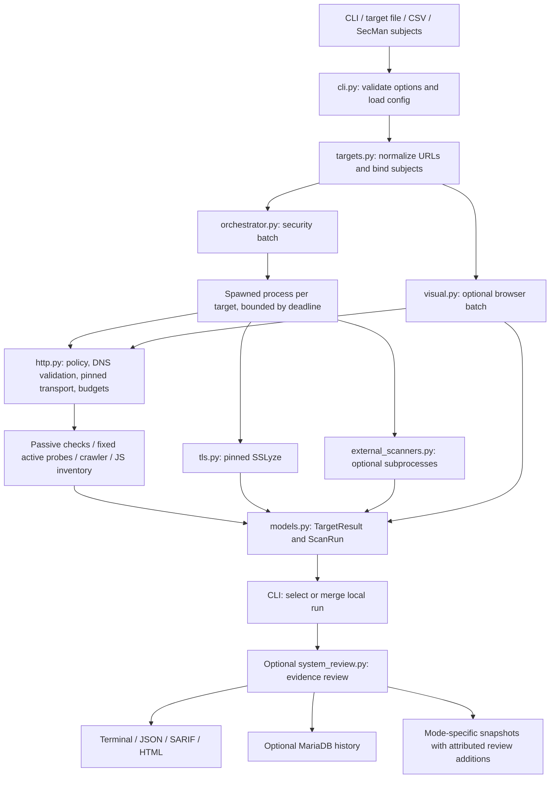

# Architecture and code guide

This describes the implemented `0.3.0` working tree after the architecture remediation.
The [original review](ARCHITECTURE_REVIEW.md) is retained as historical assessment;
[implementation status](IMPLEMENTATION.md) records its resolution and validation limits.
Operator commands are in [CLI.md](CLI.md).

## Purpose and boundaries

The application is a bounded scanner of explicitly supplied HTTP(S) targets. Its
default security pass collects HTTP evidence and runs TLS certificate/protocol inventory.
TLS vulnerability probes have an independent explicit opt-in. It can optionally
crawl public pages, run fixed active probes, invoke external scanners, capture pages
in Chromium, or send selected evidence to OpenRouter. It is not a general authenticated
DAST engine. No service, database, or SecMan deployment is required for local reports.

Here, **passive** means the built-in HTTP active-probe catalogue is disabled. A default
scan still makes requests and performs multiple certificate/protocol TLS handshakes. It is not passive network observation. See the TLS policy concern in the review.

The flat `src/` directory is mapped to the installed `secman_web_check` package by
`pyproject.toml`; imports use the installed package name. The console entry point is
`secman_web_check.cli:app`; `__main__.py` also supports module invocation.

## Runtime flow

A shared `TrafficController` spans the entire CLI run and is passed to spawned workers,
browser collection and provider calls through multiprocessing-manager state. Admission
limits per origin and globally, cancellation, call ceilings and worker-lease reclamation
are shared. HTTP hops and TLS TCP connects are individually admitted. External HTTPS
CONNECT tunnels are admitted as connections and bounded by bytes/time plus tool pacing.
These counters do not count encrypted requests or individual TLS messages inside a tunnel.

### Security pass

1. `cli.scan` validates mutually exclusive target sources and option combinations,
   loads `ScannerConfig`, and constructs optional crawl, agent, review, and visual options.
2. `scan_all` schedules up to `concurrency` tasks in a `ThreadPoolExecutor`. Each task
   starts a spawned process through `_bounded_scan_target`. Results remain in input
   order; progress callbacks arrive in completion order.
3. `scan_target` creates an HTTP collector with a shared per-target request budget and
   deadline. It collects the initial URL and redirects, then `/.well-known/security.txt`
   on the effective origin. Transient evidence feeds the passive checks.
4. Fixed active probes run if enabled. An enabled AI agent selects probes instead of
   the normal full active sequence. Cross-origin initial redirects skip active probes,
   directory discovery, external scanners, and agent actions. Crawl has its own scope
   check; JavaScript collection follows the collector's current origin policy.
5. Directory discovery and external tools run only after a final HTTP 200 response.
   Optional JavaScript inventory inspects references on the initial collected page.
   TLS checks use the effective target. Component detection uses response metadata and
   HTML references, with local version matching against bundled advisories.
6. Optional crawling applies passive checks and component detection to collected child
   pages. It does not run every active probe, TLS scan, or JS inventory on every page.
7. Findings are deduplicated by external identity; components by component key.
   Errors and coverage determine `SUCCESS`, `PARTIAL`, or `FAILED` and completeness.

The parent terminates an expired target worker and its process group on POSIX, retaining
sibling results. Direct `scan_target` calls do not have that process boundary. SSLyze direct connections use the narrow `tls_transport.py` hook: every TCP dial
revalidates DNS and holds a shared admission lease until its socket closes. Python
global sockets are not patched. The supported SSLyze 6.x helper is restored after scanning.

### Visual pass

`scan_visual_all` runs deadline-enforced spawned target workers. Each worker starts an
asyncio browser pass with a fresh context; screenshot indices are preserved across workers.
Capture concurrency uses `ScannerConfig.concurrency`. Service workers and selected
network APIs are blocked. HTTP(S) requests are intercepted and fulfilled through
`HttpCollector.collect_one`; only GET/HEAD and selected origins are accepted. Cookie
headers are stripped; browser session replay is not implemented.

Each capture has a 200-request budget at 1 request/second per origin. A successful HTTP
200 page produces a local PNG capped at 4000 pixels in height. Other responses are not
captured. These local screenshots can contain sensitive visible content and need an
operator retention policy.

Screenshot-only results can have `status=SUCCESS` while `complete=False`: collection
succeeded, but no visual findings were evaluated. Remote visual analysis requires a
separate operator-reviewed crop with the matching screenshot filename. The code rejects
an identical raw screenshot; it cannot determine whether a crop is adequately redacted.
The model sees the crop, origin, and status, not captured page text.

Combined mode runs security and visual passes sequentially, then `merge_runs` combines
their same-target results. SecMan snapshots remain separate. The merge preserves script/API inventory, evidence records and analysis attribution.

## Module responsibilities and extension points

Paths in this table are relative to the repository root.

| Module | Responsibility and principal API | Relevant tests |
| --- | --- | --- |
| `src/cli.py` | Typer commands, validation, progress, output and adapter ordering | `test_cli.py` |
| `src/coverage.py` | Versioned manifests, catalogue/detector revisions and check outcomes | Architecture remediation tests |
| `src/traffic.py` | Run/origin admission, cancellation, shared limits and leases | `test_traffic.py` |
| `src/tls_transport.py` | Per-socket SSLyze pinning, DNS validation and admission | `test_tls_policy.py` |
| `src/provider.py`, `src/provider_dns.py` | Shared provider policy, bounded requests and interruptible DNS | Agent/visual/review tests |
| `src/api_inventory.py` | Bounded local OpenAPI and observed fetch/XHR metadata | `test_api_inventory.py` |
| `src/browser_discovery.py` | Rendered anchors and read-only API discovery without screenshots | `test_browser_discovery.py` |
| `src/intelligence.py` | Explicit OSV updates, checksum snapshots, offline SEMVER matching | `test_intelligence.py` |
| `src/external_profile.py`, `src/external_proxy.py`, `src/external_worker.py` | Pinned reviewed assets, proxy-only native containment and output limits | `test_external_containment.py` |
| `src/evaluation.py` | Labeled fixture measurements and regression gate | `test_evaluation.py` |
| `src/config.py` | Immutable `ScannerConfig`; `load_config` precedence and coercion | `test_config.py` |
| `src/targets.py` | `NormalizedTarget`, target loaders, `AddressPolicy`, `resolve_allowed` | `test_targets.py` |
| `src/http.py` | `HttpCollector`, transient evidence, `PinnedNetworkBackend`, `RequestBudget` | `test_http.py` |
| `src/orchestrator.py` | Single-target stages, worker deadlines, batch ordering and coverage | `test_orchestrator.py` |
| `src/checks/registry.py` | `CheckContext`, `Rule`, immutable rule catalogue | Header/content/cookie/CORS/active tests |
| `src/checks/{headers,cookies,cors,content}.py` | Pure passive checks over evidence; registration in `checks/__init__.py` | Corresponding `test_*_checks.py` |
| `src/checks/redirects.py` | Hop and blocked-redirect findings | `test_redirect_checks.py` |
| `src/checks/active.py` | Fixed probe definitions, execution, deterministic signature matching | `test_active_checks.py` |
| `src/tls.py` | Approved-IP SSLyze execution and translation into rules | `test_tls.py` |
| `src/components.py` | JS/CSS/server fingerprints, inventory sanitization, offline advisory ranges | `test_components.py` |
| `src/crawler.py` | Origin-scoped queue, HTML/robots/sitemap discovery, literal OpenAPI GET seeds | `test_crawler.py` |
| `src/discovery.py` | Fixed non-recursive directory/path discovery | `test_discovery.py` |
| `src/external_scanners.py` | Nuclei/Nikto arguments, subprocess lifetime and output normalization | `test_discovery.py` |
| `src/javascript.py` | Referenced script collection and metadata/checksum inventory | `test_javascript.py` |
| `src/agent.py` | OpenRouter selection of approved active check IDs | `test_agent.py` |
| `src/visual.py` | Chromium interception, PNG capture, redacted-crop analysis and local merging | `test_visual.py`, `test_visual_browser.py` |
| `src/system_review.py` | Prompt loading, evidence projection, OpenRouter result parsing and merging | `test_system_review.py`, `test_cli.py` |
| `src/models.py` | Immutable findings, components, exposure, coverage, target/run results | `test_models.py` |
| `src/reports/` | Terminal/JSON/SARIF/HTML, atomic file writes and JSON comparison | `test_reports.py`, `test_compare.py` |
| `src/storage.py` | TLS MariaDB connection, schema versions 1–4, transactional save, history | `test_storage.py` |
| `src/secman.py` | Subject identity/matching, REST v1 client and atomic snapshot serialization | `test_secman_integration_results.py` |
| `src/prompts/` | Packaged default, AWS, and secrets review prompts | `test_system_review.py` |
| `scripts/` | Setup, verification, scan wrappers, environment-only secret resolution | AWS/Proton wrapper tests |
| `db/` | SQL migrations and example grants; runtime migration SQL also lives in `storage.py` | `test_storage.py` |

## Data model and identity

All shared scan records are frozen dataclasses. Timestamps normalize to UTC.

| Type | Meaning |
| --- | --- |
| `NormalizedTarget` | Normalized request URL, host/port/scheme, optional AWS account and exact SecMan binding |
| `HttpResponseEvidence` | In-memory request, status, redacted headers, bounded body, truncation and redirect evidence; never serialize this object as a report |
| `Finding` | Rule, stable external ID, severity, confidence, remediation, bounded evidence, engine/model |
| `DetectedComponent` | Name/category/version with detection evidence and stable component key |
| `JavaScriptAsset` | Fetched URL, SHA-256, retained byte count, status and truncation; no script bytes |
| `ExposureObservation` | Configured/effective URL, observed status/reachability and response size |
| `CoverageSummary` | Pages, HTTP/crawl counters, agent counters and completion flags |
| `TargetResult` | Findings and inventories plus errors, status and independent completeness flags |
| `ScanRun` | UUID, ordered targets, timestamps and scan profile |

`Finding.create` hashes `rule_id + unit-separator + public_url(url)`. Query and fragment
are removed by `public_url`. Consequently, two findings for the same rule and path
share an identity even if their query parameters or model-generated titles differ.
An explicit `identity_context` can distinguish evidence domains. Review observations
include their sorted evidence references in that context, separating same-category
observations. Query parameter values are never retained; query-bearing input cannot
establish absence-based resolution.

`DetectedComponent.create` hashes category, case-folded name, and version. Components
of the same version on several pages collapse to one target-level record. Neither a
filename fingerprint nor a server banner proves exploitable code is executing.

`Reachability.AUTHENTICATED` currently means the exact AWS API Gateway response-body
marker matched. It does not mean the scanner authenticated, and general 401/403
responses are not mapped to that value by a comprehensive authentication classifier.

## Network and data trust boundaries

`normalize_target` rejects unsupported schemes, URL credentials, fragments, and invalid
syntax. `resolve_allowed` rejects a DNS result set if any address violates policy.
Private-target opt-in permits RFC1918/ULA only; special-purpose ranges remain denied.

The collector resolves each hop, pins an approved IP, and retains the original hostname
for Host, SNI, and certificate verification. It disables environment proxies and HTTP
automatic redirects, then implements redirect checks itself. Body size, redirect count,
socket timeouts, cumulative request deadline, and target deadline are bounded. Collector
clones retain shared request budget/deadline state. DNS blocking is bounded by the outer
security worker, not by the synchronous resolver itself.

HTTP evidence bodies stay in memory. Deterministic rules must emit signatures rather
than excerpts or secret values. Reports and optional adapters receive normalized results.
This is a producer contract, not a universal sanitizing serializer: producers and serializers use the shared public-location projection. The review
projection contains only typed observation IDs and approved metadata.

SSLyze, external tools and providers have explicit adapter contracts. TLS sockets share
admission with HTTP/browser collection. External engines require exact binary/asset hashes,
a reviewed profile and a supported OS sandbox; their only allowed egress is a local
scope proxy. Root-only authorization avoids silently expanding application-path targets.
Native output is capped before parsing, and response bodies are omitted. Unsupported
containment fails closed.

Three optional AI features share provider policy and bounded pinned JSON transport:
`agent.py` selects approved IDs, `visual.py` selects fixed categories from operator-reviewed
crops, and `system_review.py` selects known evidence references. Model free text and
invented evidence are rejected rather than persisted. Model outputs are marked for human
review. Stage records carry timestamps, prompt hash, model and privacy-policy version.
Provider DNS uses an interruptible child and streams use cumulative deadlines.

Browser discovery is separate from visual reporting: it follows rendered anchors within
scope, collects transient response evidence, inventories fetch/XHR names/types and blocks
writes/session replay. OpenAPI inventory retains declared placeholders and unexecuted
methods; it never fills values or dereferences remote schema URLs.

Maintained intelligence is loaded from an operator-checksummed local OSV snapshot.
Updates are explicit by package or advisory ID, atomic and bounded; scans upload no
inventory to the intelligence service. Hash, sources, freshness and unsupported ranges
are recorded. The bundled legacy subset remains an explicitly labeled offline fallback.

## Outputs, persistence and lifecycle

Reports use atomic writes; JSON emits schema `1.3`, SARIF `2.1.0`. HTML is
escaped and script-free. JSON is the richest local record. SARIF focuses on findings.
`compare_reports` confirms absence only for complete successful passive targets with a
validated identical manifest/hash and an executed check domain. Legacy manifests,
query-bearing contexts and model/variable-agent absences remain unconfirmed. Findings
reference typed evidence records; coverage distinguishes positive/negative, skipped,
unsupported, failed and exhausted checks.

MariaDB schema 4 retains the complete normalized JSON report in the same transaction as
summary/detail tables. `history export` returns this archive; older runs fail as
summary-only. Archive round-trip, rollback and runtime/SQL migration parity are tested.
Local PNGs remain separate artifacts with operator-controlled retention.

SecMan uses HTTPS REST `/api/integrations/v1`. Exact bound subject/asset identities take
precedence over normalized URI/hostname matching; ambiguity fails. AWS CSV account IDs
constrain matching. Each target snapshot has a deterministic run key. Baseline, extended,
and visual scanner identities separate their finding lifecycles. Extended and visual
uploads are explicitly non-terminal for coverage; partial results must not resolve
previous findings. Local comparison and remote lifecycle semantics need separate tests.

The CLI writes deterministic artifacts before optional review and then writes enriched
results before storage/upload. A later provider failure retains earlier target results
and records incomplete review coverage. Review additions and provenance reach the primary
mode's non-terminal SecMan snapshot. Baseline terminal coverage additionally requires
`SECMAN_BASELINE_PROFILE_SHA256` to approve the exact current manifest; otherwise uploads
are non-terminal. This avoids clearing findings across changed catalogues, limits or
scope when the remote API does not enforce profile equivalence itself.

## Making a bounded change

For a passive rule, add stable metadata in `checks/registry.py`, implement the check in
the relevant check module, and register a new module in `PASSIVE_CHECKS` only if needed.
Checks consume `CheckContext` and return findings; they should not open network clients.
Include positive and negative fixtures, content-type handling, truncation behavior,
redaction assertions, and report checks where output changes.

For a new probe, define its exact method, path, headers, maximum requests, signature,
safety class, and scope before adding it to the fixed active catalogue. Use the shared
collector and test refused redirects/addresses, exhausted budgets and negative matches.
Only reviewed action IDs may become agent choices. Keep active behavior opt-in.

When adding a result field, inspect `models.py`, all reports, `merge_runs`, storage,
SecMan serialization, system-review evidence, comparison and their tests. Not every
adapter needs every field, but document intentional omissions and test them. If SQL
changes, update both the runtime migrations and `db/migrations` equivalents.

Run `./scripts/verify.sh` for the lockfile, tests, lint, format, strict types and package
build. Install the matching Playwright Chromium first. Tests use synthetic transports
and adapters; a passing suite does not prove live-provider or SecMan compatibility.
